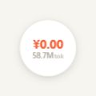
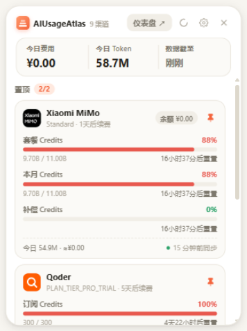
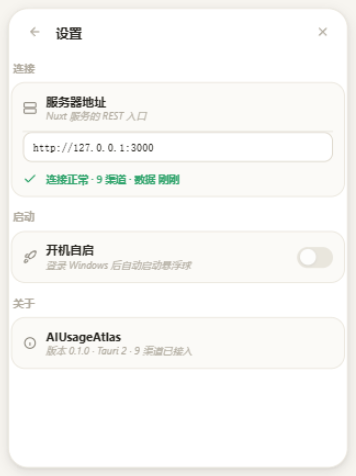

# AIUsageAtlas

<p align="center">
  
</p>

自托管的「AI 供应商额度与用量聚合器」：把各 AI 平台/代理平台的额度、配额窗口、订阅计划、每日用量和费用汇总到一个本地仪表盘。

## 功能

- **仪表盘**：今日 Token/费用汇总、30 天续费提醒、每渠道卡片（计划、余额、配额窗口倒计时、今日用量、迷你趋势）
- **供应商详情**：账户信息、计划与续费、配额窗口、近 30 日用量图、模型用量明细（含价格对照）、同步间隔配置、同步日志、删除
- **价格表**：模型输入/输出/缓存价格（官方核价随代码维护 + 渠道插件自带价目，LiteLLM 快照自动刷新待接入）
- **设置**：显示币种与汇率、时区、访问令牌管理、告警规则
- **桌面悬浮球**（Tauri 2 · Windows）：常驻置顶白瓷球显示今日费用/Token，单击展开分组面板，贴边收纳、开机自启
- 手动刷新（全局/单渠道），采集按渠道插件化、可配独立间隔

## 快速开始

### Docker 部署（推荐）

```bash
docker compose up -d
# 打开 http://localhost:3000
```

数据持久化在 `./data`（SQLite + 凭证）。

### 本地开发

```bash
npm install
npm run dev        # http://localhost:3000
```

> 注意：本项目锁定 `nuxt@3.18.1`。3.17.x 在部分环境 dev 模式有 module runner 403 问题，请勿随意升级。

## 桌面悬浮球客户端（Tauri 2 · Windows）

常驻桌面的悬浮球：白瓷球体显示**今日费用 / 今日 Token**，单击展开分组面板，双击打开 Web 仪表盘，
拖拽贴边自动收纳（悬停边条滑出）。

<table>
  <tr>
    <td align="center"><br><sub>白瓷球 · 四态</sub></td>
    <td align="center"><br><sub>置顶 + 全部渠道</sub></td>
    <td align="center"><br><sub>设置抽屉</sub></td>
  </tr>
</table>

**能力一览**

- **悬浮球**：白瓷底 + 珊瑚费用数字；服务未连接 = 红描边 `!`，数据过期 = 灰点，贴边收起只留月牙
- **面板分组**：三格汇总条（费用/Token/数据时间）→「置顶」组（**自选最多 2 个**，第 3 个挤掉最早；展示全部额度窗口 + 余额 + 今日/同步脚注）→「全部渠道」单行（余额 · 最紧张百分比 · 紧凑倒计时 · 图钉，按紧张度降序）
- **设置抽屉**：服务器地址（输入即生效，带连接自检）、开机自启（写 `HKCU\Run`）、关于
- **交互**：贴边磁吸（距边缘 12px 内吸附，四边/角落/跨屏）+ 边缘收纳动画（800ms 延迟收回、悬停滑出）；面板弹出按球的方位选锚点回弹，点球球体同步弹跳
- **数据**：`GET /api/dashboard` 60s 轮询 + `POST /api/sync` 手动同步，与 Web 仪表盘同源同口径

```bash
cd desktop
npm install
scripts\tauri-dev.bat      # 开发（自动加载 VS2019 vcvars，勿用裸 npm run tauri dev）
scripts\tauri-exe.bat      # 只出 prod exe（tauri build --no-bundle）
scripts\tauri-build.bat    # 完整打包：NSIS 安装包 + MSI
```

> 设计细节与 Windows 坑位（SM_CXMINTRACK 钳宽、DWM 方形阴影、裸 cargo 编出 dev 空窗二进制、
> HTCAPTION 拖拽失效等）见 [desktop/README.md](desktop/README.md)。

## 目录结构

```
├── pages/               # 页面（仪表盘/详情/价格表/设置）
├── components/          # AppHeader 等
├── desktop/             # Tauri 2 桌面悬浮球（独立子项目，见 desktop/README.md）
├── docs/                # 架构/数据模型文档 + screenshots（README 配图）
├── public/              # 图标：icon.svg（矢量源）/ favicon.ico / apple-touch-icon.png
├── scripts/             # 诊断脚本与图标生成（node scripts/generate-icons.mjs）
├── server/
│   ├── api/             # REST 接口
│   ├── middleware/      # CORS 等（桌面客户端跨域依赖）
│   ├── providers/       # 渠道插件框架 + 各渠道实现
│   └── utils/           # SQLite 连接、建表、同步器、浏览器会话
├── shared/types.ts      # 前后端共享类型
└── assets/css/main.css  # 消费级明亮风设计系统
```

## 数据模型

15 张表的字段、ER 图、采集落库数据流与写入语义见 [docs/02-data-model.md](docs/02-data-model.md)；选型层面的说明在 [docs/01-architecture.md](docs/01-architecture.md) §2.2。

## 渠道插件

采集按渠道插件化，每个插件实现统一接口（`server/plugins/types.ts`）：

```ts
interface ProviderPlugin {
  id: string
  displayName: string
  authMethods: AuthKind[]      // 'apikey' | 'cookie' | 'browser-login'
  scheduleDefaultSec: number
  fetch(ctx, cred): Promise<PluginFetchResult>  // 归一化快照
}
```

同步流程：`/api/sync` → `sync-runner` 加载凭证 → 调插件 → 归一化写入 SQLite → 记录 `sync_log`（错误分类：`auth_expired` / `endpoint_changed` / `network` / `parse` / `not_configured`）。**没有凭证就不产数据**：同步记为 `not_configured` 失败，界面上是空态，不用模拟值填充。

**自动同步**：内置轻量调度器（`server/plugins/scheduler.server.ts`）每 60s 检查一次，按各供应商 `sync_config.interval_sec` + 抖动到期执行，日志自动裁剪（每渠道保留最近 100 条）。添加供应商时会立即触发一次后台同步。

> 注意目录约定：`server/plugins/` 是 Nitro 的插件目录（只放带 default 导出的 nitro 插件），**渠道插件框架在 `server/providers/`**，两者不要混放。

### 凭证方式

| 方式 | 适用 | 说明 |
|------|------|------|
| **浏览器登录（推荐）** | 完整数据（套餐/用量/余额） | 弹出真实浏览器登录一次，会话持久化在 profile；之后每次同步启动无头浏览器加载控制台页面，短效 token 由页面自动刷新，RPC/REST 在页面上下文内执行。登录窗口用完即可关闭。Docker 部署需显示环境（Xvfb/VNC） |
| API Key | 各渠道官方开放接口覆盖的数据面 | 稳定；但多数渠道的订阅/控制台数据面 Key 拿不到（逐渠道见「已实现渠道」） |
| 粘贴 Cookie | 临时 | 短效 token 渠道基本必失败（如 StepFun Oasis-Token 仅 30 分钟寿命且绑定会话），仅作应急调试手段 |

### Cookie 获取引导

Cookie 类渠道内置引导流程（[components/CookieGuide.vue](components/CookieGuide.vue)，引导内容由插件的 `cookieGuide` 元数据提供）：

1. **分步图文引导**：打开登录页 → F12 开发者工具 → Network 标签 → 复制请求头里的 Cookie → 粘贴保存
2. **书签小工具**：弹窗里有个「拖我到书签栏」按钮，拖到书签栏后，在平台页面点击即可自动复制 Cookie 到剪贴板（HttpOnly Cookie 不适用时会提示改用手动步骤）
3. **保存即验证**：粘贴后点「验证并保存」，系统立即同步一次——成功则开始采集，失败则在弹窗内显示具体原因（如「Cookie 已失效，请重新获取」），可当场重试
4. **过期更新**：详情页「更新凭证」按钮随时重新走引导流程（`POST /api/providers/[id]/credential`，保存后自动同步验证）

### 已实现渠道（9 个，与 `server/providers/index.ts` 注册表顺序一致）

浏览器登录型渠道依赖 Playwright：`npm i -D playwright && npx playwright install chromium`（Docker 镜像内需一并安装）。各渠道端点均无官方完整文档，主要从前端 bundle 逆向 + 真实账号实测得出，头注释里有逐条核对日期。

#### StepFun（`stepfun.ts`）

| 凭证 | 取数内容 | 关键点 |
|------|---------|------|
| API Key | `GET https://api.stepfun.com/v1/accounts`（官方文档接口）：余额、账户类型、累计充值/赠送 | 官方 API **不提供** Step Plan 用量/配额查询（`/step_plan/v1/accounts` 实测 404，文档索引已核对），控制台 RPC 是唯一途径 |
| Cookie / 浏览器登录 | 直连控制台内部 Connect-RPC（端点从前端 bundle 的 protobuf 描述逆向获得）：`GetStepPlanStatus`（订阅/到期/自动续费/计划价格）、`QueryStepPlanUsages`（套餐 Credits 按模型按天用量）、`DevQueryUsageHistory`（按量计费明细）、`QueryAccountBalance`（余额）、`UserInfo`（账户）；失败降级 Playwright 捕获 XHR 重新发现端点 | **RPC 必须带头 `connect-protocol-version: 1` + `oasis-appid: 10300` + `oasis-platform: web`**，缺头会把合法 token 判为 "oasis-token is embezzled" 401 |

控制台 RPC 端点：`POST https://platform.stepfun.com/api/step.openapi.devcenter.Dashboard/{GetStepPlanStatus,DevQueryUsageHistory,QueryAccountBalance}`，请求头带登录 Cookie。金额字段单位为「分」（如套餐价 `9900` = ¥99）。

#### Xiaomi MiMo（`xiaomimo.ts`）

| 凭证 | 取数内容 | 关键点 |
|------|---------|------|
| API Key | `GET /v1/models` 探活/模型列表 | 平台无对外计费/用量 API（`/v1/dashboard/billing/*` 等一律 404），此模式拿不到余额 |
| 浏览器登录 / Cookie | `POST /api/v1/usage/detail/list`（按量账单，按天×模型，含金额）、`POST /api/v1/usage/token-plan/list`（Token Plan 套餐，按天×模型）、`GET /api/v1/usage`（累计用量）、`GET /api/v1/userProfile`（脱敏联系方式） | **两条用量流必须都收**：订阅账号消耗几乎全在套餐流，只收账单流图表会停在几个月前；POST 必须带 Cookie 里 `api-platform_ph` 派生的 query 参数（值带引号要先剥，否则全 401）；会话页加载前用长效 passToken 预换发 serviceToken（`preNavigate`），防过期快照触发全局登出 |

#### DeepSeek（`deepseek.ts`）

| 凭证 | 取数内容 | 关键点 |
|------|---------|------|
| API Key | `GET /user/balance` 余额、`GET /models` 模型列表 | 官方无按日用量/配额接口；社区流传的 `/v1/dashboard/billing/*` 用有效 Key 实测 404 |
| 浏览器登录 | 控制台 `GET /api/v0/usage/by_api_key/amount`（按模型 30 天用量时序）、`…/cost`（按日真实消费）、`/api/v0/users/get_user_summary`（总用量，进 notes） | **必须是平台会话**（Bearer Key 被拒 code:40003）；token 取自 localStorage `userToken`（appKit 包装的 JWT）拼 `Authorization: Bearer` 头，裸 Cookie 必 40002；`tz=28800` 对齐自然日 |

Key 与会话两路合并（`mergeSessionUsage`）：Key 管余额/模型，会话管用量/费用。

#### BigModel 智谱（`bigmodel.ts`）

| 凭证 | 取数内容 | 关键点 |
|------|---------|------|
| API Key | `/api/monitor/usage/model-usage`（按模型用量，7 天分片小时槽聚合到日）、`/api/monitor/credit-usage/usage-detail`（Code Plan 积分平面，优先）、`/api/monitor/usage/quota/limit`（5 小时/周额度桶）、`/api/biz/account/query-customer-account-report`（余额/累计充值消费）、`/api/biz/subscription/list`（订阅/价格/自动续费/下次续费日）、`/api/finance/expenseBill/expenseBillListByDay`（按日真实账单，含订阅扣费行） | 全部走 `Authorization: Bearer`；**标准 Key 与 Coding Plan Key 不通用**，`/api/paas/v4` 与 `/api/coding/paas/v4` 两个基座都要试，只试标准基座会把合法 Coding Plan Key 误判失效 |
| 浏览器登录 | 同上全数据面（与 Key 模式共用采集逻辑） | 控制台接口**只认 Bearer 不认裸 Cookie**（仅 Cookie 回 200 + code:1001）；登录 token 在 JS 可读的 Cookie 里，页内自拼 Bearer 头 |

按日账单出账有 T+1~2 延迟；社区流传的 `POST /api/balance` 已 404，勿复活。

#### OpenCode（`opencode.ts`）

| 凭证 | 取数内容 | 关键点 |
|------|---------|------|
| API Key | `GET /zen/v1/models` 探活、`GET /inference/go/v1/usage`（Go 订阅滚动/周/月配额）、`GET /console/api/usage/cost-by-day`（按日费用/Token/请求数）、`…/usage/models`（按模型累计分页）、`…/usage/summary`（窗口合计）、`GET /console/api/v1/budgets/members`（成员预算） | **金额单位 microcents = 1e-8 美元**（换算一律 /1e8，按 1e-6 算会放大 100 倍）；`cost-by-day` 的 range 只认 `7d`·`30d` |
| 浏览器登录 | 控制台会话补 `/console/api/go/status`（续费日/是否续订）、`/console/api/billing/invoices`（订阅价格），对 API Key 403 | `loadCredential('apikey')` 混合两路；`/console/api/*`（除 user/orgs）必须带 `x-org-id` 头；budgets 返回**裸数组**而非 `{members:[…]}` |

#### 通义 百炼（`tongyi.ts`）

| 凭证 | 取数内容 | 关键点 |
|------|---------|------|
| API Key | `GET /compatible-mode/v1/models` 探活；旧版管理接口 `GET /api/v1/models`（分页全量模型库 350+ 条，含官方价目 → 落 `model_price`，`source='official'` 只补缺） | 余额/按日用量/费用 Key 侧全 404，百炼官方 OpenAPI 也无用量账单（唯一官方通道是阿里云 BSS，未实现） |
| 浏览器登录 | 阿里云账号会话：`/tool/user/info.json`、`/data/api.json` + 控制台费用/用量页流量发现 | 用量接口 Action 尚未固化，每次同步用 `captureApiTraffic` 记录真实请求逐轮补全；采不到的计划字段红字「未获取到」 |

#### 火山引擎 方舟（`volcengine.ts`）

| 凭证 | 取数内容 | 关键点 |
|------|---------|------|
| AK/SK | 方舟 OpenAPI `POST https://ark.cn-beijing.volcengineapi.com/?Action=GetInferenceUsage&Version=2024-01-01`：按日/时用量（列式响应，InputTokens/OutputTokens/TotalTokens/ReqCnt） | **HMAC-SHA1 签名，仅支持 Access Key**（凭证存 `aksk` 型 credential，值 `AccessKeyId·AccessKeySecret`）；Filters 传 `{Key, Values:[]}` 可把该列加进返回（不过滤）——用 BillingStatus + ModelName 一次拿计费平面与模型维度 |
| 浏览器登录 | 备选：BFF `GetConsoleUser` + `/ark/bff/api/{region}/{ver}/{Action}` 页内调用 | BillingStatus `normal` = 按量付费平面，`free_for_*`·`no_need_billing` = 订阅/赠送平面 |

`GetUsageDetails`（AgentPlan 套餐明细）与推理用量重叠，v1 不入库防双计。

#### Trae（`trae.ts`）

| 凭证 | 取数内容 | 关键点 |
|------|---------|------|
| 浏览器登录 | 会话 RPC：`/cloudide/api/v3/trae/CheckLogin`、`…/GetUserInfo`、`/trae/api/v2/pay/cn_credits_billing_status`、`/trae/api/v2/pay/user_current_entitlement_list`（`usage_summary` 积分用量 + 会员套餐描述） | **字节 WAF（SLARDAR/glue）只放行页面自身发出的请求**，evaluate 直调 fetch 一律返回挑战页 HTML——必须用 `captureJsonResponses`（页面加载触发真实请求后收响应体）；无任何 API Key 数据面；价格字段单位未证实，红字「未获取到」不编数字 |

#### Qoder（`qoder.ts`）

| 凭证 | 取数内容 | 关键点 |
|------|---------|------|
| 浏览器登录 | `GET /api/v1/me`（账号）、`GET /api/v1/me/userplan`（套餐名/价格/到期/自动续费/计费周期）、`GET /api/v2/me/usages/big_model_credits`（订阅 + 资源包两组配额窗口）、`GET /api/v1/me/cost-center/credits/daily-trend`（近 30 天按日 credits/参考成本/消息数）、`GET /api/v1/me/usages/big_model_credits/histories`（逐条调用按模型聚合，≤5 页） | **双站点独立域名**：国内站 qoder.cn（阿里账号·CNY）与全球版 qoder.com/zh（USD），插件 `sites` 声明、添加供应商时选择（locale 路径 ≠ 站点归属）；**credits 是消耗单位非 token**，落 `input_tokens` 列、按 credits 语义展示 |

新增渠道：在 `server/providers/` 新建插件文件，到 `server/providers/index.ts` 登记即可。

## 当前状态（MVP）

- **9 家渠道插件已接入**：DeepSeek / BigModel 智谱 / StepFun / Xiaomi MiMo / OpenCode / Qoder / 通义 / 火山引擎 / Trae（各家凭证方式见详情页与上文「渠道插件」章节）
- **桌面悬浮球客户端 v0.1**（Tauri 2 · Windows）已实现：白瓷球、置顶分组面板、设置抽屉、贴边收纳、开机自启
- 无凭证不产数据：同步记 `not_configured`，界面呈空态，不用模拟值填充
- 后续阶段：凭证加密存储、REST Bearer 鉴权、告警通知通道
