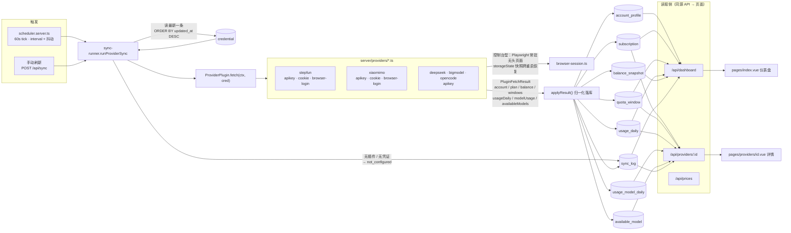

# 数据结构设计

> 校准日期：2026-10-21，对应 `server/utils/db.ts` 的 15 张表与 `server/utils/sync-runner.ts` 的落库语义。
> 改表时这份文档要一起改：下面的字段和写入规则都是从代码逐条核对出来的。

## 1. 设计原则

| 决定 | 原因 |
|---|---|
| 单文件 SQLite（`node:sqlite` + WAL），路径 `$DATA_DIR/aiusageatlas.db` | 免原生编译，Docker 里挂一个 `/data` 卷就是全部状态 |
| **不声明 FOREIGN KEY** | 表之间靠 `provider_id` 逻辑关联；删供应商由 `providers/[id].delete.ts` 逐表清理，显式列清单比级联规则更好审计 |
| 主键即幂等键 | 同步可重复执行，靠 `INSERT … ON CONFLICT DO UPDATE` 收敛，不依赖事务串行 |
| 时间一律 TEXT | 日期 `YYYY-MM-DD`；时刻混用 SQLite `datetime('now')`（UTC 空格分隔）与插件给的 ISO 串，读取侧统一走 `new Date()` 解析 |
| `plan_name` 进入三张表的主键 | 同一账号可并存「订阅套餐 + 按量付费」两个计费平面，见 §5 |
| 空态即空态 | 没有凭证就不产数据（`sync_log` 记 `not_configured`），不用模拟值填充 |

## 2. ER 图

```mermaid
erDiagram
    provider           ||--o| account_profile  : "1:1"
    provider           ||--o{ subscription      : "1:N"
    provider           ||--o{ credential        : "1:N"
    provider           ||--o| sync_config       : "1:1"
    provider           ||--o{ sync_log          : "1:N"
    provider           ||--o{ alert_rule        : "1:N"
    provider           ||--o{ balance_snapshot  : "1:N"
    provider           ||--o{ available_model   : "1:N"
    provider           ||--o{ usage_model_daily : "1:N"
    provider           ||--o{ model_price       : "1:N"
    subscription       ||--o{ quota_window      : "provider_id + plan_name"
    subscription       ||--o{ usage_daily       : "provider_id + plan_name"
    available_model    ||--o{ model_price       : "provider_id + model_id"

    provider {
        TEXT id PK "如 stepfun-mvgdrpev"
        TEXT plugin_id "指向 server/providers 注册表"
        TEXT display_name
        TEXT category "subscription|api|aggregate"
        TEXT icon "public/icons 本地资源"
    }
    account_profile {
        TEXT provider_id PK
        TEXT user_name
        TEXT masked_contact "脱敏手机号/邮箱"
        TEXT region
        TEXT avatar_text
    }
    subscription {
        TEXT provider_id PK
        TEXT plan_name PK
        TEXT billing_mode "subscription|api|hybrid"
        REAL price
        TEXT currency
        TEXT renewal_date "下次续费日"
        INTEGER auto_renew
    }
    quota_window {
        TEXT provider_id PK
        TEXT plan_name PK
        TEXT name PK "如 每周额度"
        REAL used_pct
        REAL used_value
        REAL limit_value
        TEXT unit
        TEXT reset_at
    }
    usage_daily {
        TEXT provider_id PK
        TEXT plan_name PK
        TEXT date PK
        INTEGER input_tokens
        INTEGER output_tokens
        INTEGER cached_tokens
        INTEGER requests
        REAL cost_amount
        TEXT source "api|balance_delta|scrape"
        TEXT billing "subscription|payg"
    }
    usage_model_daily {
        TEXT provider_id PK
        TEXT date PK
        TEXT model_id PK
        INTEGER thinking_tokens
        INTEGER errors
        TEXT billing
    }
    balance_snapshot {
        TEXT provider_id PK
        TEXT date PK
        REAL balance
        REAL recharged_amount "由余额下降低推算出的充值"
    }
    available_model {
        TEXT provider_id PK
        TEXT model_id PK
        TEXT fetched_at
    }
    credential {
        TEXT provider_id PK
        TEXT kind PK "apikey|cookie|browser-login"
        TEXT payload_enc "当前为明文 JSON，见风险项"
        TEXT expires_at
    }
    sync_config {
        TEXT provider_id PK
        INTEGER enabled
        INTEGER interval_sec
        INTEGER jitter_sec
    }
    sync_log {
        INTEGER id PK
        TEXT provider_id
        TEXT status "ok|failed"
        TEXT error_type "auth_expired|endpoint_changed|network|parse|not_configured"
        TEXT error_msg "同时承载采集 notes"
    }
    model_price {
        TEXT provider_id PK
        TEXT model_id PK
        TEXT effective_from PK "价格版本化"
        TEXT source "official|litellm|manual"
        REAL input_per_m
        REAL output_per_m
        REAL cached_read_per_m
    }
    alert_rule {
        INTEGER id PK
        TEXT provider_id
        TEXT metric "used_pct|balance"
        REAL threshold
    }
    api_token {
        INTEGER id PK "供客户端调用"
        TEXT token_hash
    }
    settings {
        TEXT key PK "display_currency|fx_rate|timezone"
        TEXT value
    }
```

## 3. 采集数据流

## 4. 写入语义（最容易写错的部分）

| 表 | 写入方式 | 关键点 |
|---|---|---|
| `account_profile` | upsert，`COALESCE(NULLIF(?, ''), 旧值)` | 空串不覆盖已有值——某个接口偶发不返回姓名时不会被抹掉 |
| `subscription` | 有则 UPDATE（只有一行，按 `plan_name` 匹配）无则 INSERT | `price/renewal_date/auto_renew` 用 `COALESCE`，插件没读到就保留旧值而不是清零 |
| `quota_window` | 逐窗口 upsert | **插件未返回的窗口保留原值**，返回的才覆盖；窗口是"当前状态"，不做历史 |
| `usage_daily` | upsert；若插件声明了 `usageWindow` 则**先删区间内旧行**再整体写 | 删旧行必须跨计划名删——插件把按量行改挂到别的计划名时，不删就会双倍计数 |
| `usage_model_daily` | upsert；`modelUsageWindow` 同理先删后写 | 主键不含 `plan_name`，模型明细天然跨计划 |
| `balance_snapshot` | `INSERT OR REPLACE`，按 `(provider_id, date('now'))` | 一天一条，是余额差分的输入 |
| `available_model` | **整体替换**（先 `DELETE` 该渠道全部行再插入） | 只有上游下架模型时列表才会缩短；`availableModels === undefined` 表示"本次没读到"，保留旧列表 |
| `sync_log` | 追加，每个渠道保留最近 100 条（调度器裁剪） | `error_msg` 字段同时承载插件 `notes`，是排查采集口径问题的第一现场 |

## 5. 三条会咬人的不变量

**① `plan_name` 进了主键，改名必须连带迁移历史。**
`applyResult()` 检测到订阅计划改名时调 `renamePlan()`，把 `usage_daily` / `quota_window` 旧名下的行一起带走（先删会撞主键的日期，再 `UPDATE plan_name`）。只改 `subscription` 会让同一天的数据在新旧两个计划名下各存一份，**求和直接翻倍**——这是本项目真实踩过的坑。

**② 两个计费平面靠 `plan_name` + `billing` 区分。**
`usage_daily` 主键含 `plan_name`，所以插件把「订阅套餐消耗」和「API 按量消耗」分挂两个计划名（按量行缺省挂 `'按量付费'`，其余用本次采集的主计划名），两行并存；`billing` ∈ `subscription|payg` 再打一次平面标记供详情页分组。查询时如果不按这两个维度过滤，同一天的 token 会被算两次。

**③ 按日费用可能不是真值，而是余额差分推算的。**
钱包型渠道（DeepSeek、BigModel）官方没有按日消费接口。`deriveDailySpend()` 在**本次采集没带任何按日金额**时，用 `上次余额 − 本次余额` 补一条 `source='balance_delta'` 的行；检测到余额上升则记为充值（写 `recharged_amount`）不计消费；隔了超过一天则放弃推算。所以看到 `cost_amount > 0` 且 `source='balance_delta'` 时，`*_tokens` 一定是 0——token 数无法由余额推出。

## 6. 已知不一致与待办

| 项 | 现状 |
|---|---|
| `credential.payload_enc` 明文 | 列名叫 `_enc` 但当前存的是明文 JSON（API Key / Cookie）。表已按加密预留，实现待补 |
| `reset_at` 格式混用 | 插件给 ISO 串，历史行可能是 SQLite `datetime` 格式；读取侧靠 `new Date()` 兜住 |
| `usage_daily.billing` / `usage_model_daily.billing` | 由 `ALTER TABLE` 补列，不在 `migrate()` 的建表语句里，新库老库同构但读代码时容易漏看 |
| 价格表无自动刷新 | `model_price` 目前只有 `price-catalog.ts` 随代码维护的官方价目；调价需要人工加新的 `effective_from` 版本 |
